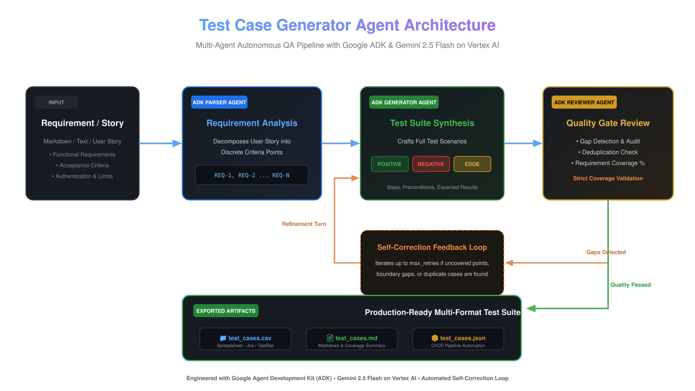
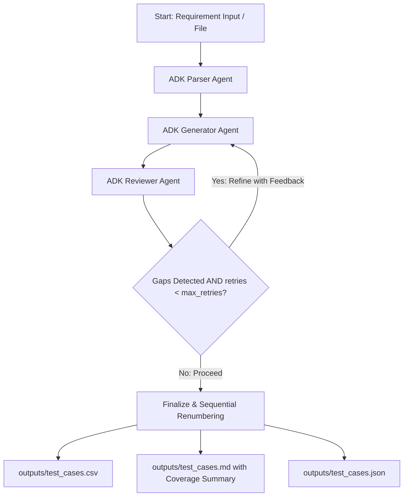

# Test Case Generator Agent (Google ADK)

A production-ready multi-agent system powered by the **Google Agent Development Kit (ADK)** and **Gemini**. The agent takes a plain-text requirement or user story, decomposes it into discrete requirement points, generates positive, negative, and edge test cases, reviews itself for gaps and duplicates, fixes them automatically in a self-correction loop, and exports clean test suites to CSV, Markdown, and JSON.

---

## 🏛️ Architecture Diagram



The system leverages a multi-agent autonomous QA pipeline built with Google ADK:



## 🎥 Video Walkthrough with Voiceover

A complete 65-second high-definition overview with professional AI voiceover is included directly in the repository:
- **Video File**: [`agent_demo_walkthrough.mp4`](agent_demo_walkthrough.mp4)
- **Audio Voiceover**: [`voiceover.mp3`](voiceover.mp3)

---

## 👤 Author & Contact

- **Author**: Aryan Yadav
- **Email**: [aryanyadav1830@gmail.com](mailto:aryanyadav1830@gmail.com)
- **Built for**: Google Cloud Build with Gemini World Tour 2026

---

## 📁 Project Structure

```text
test-case-agent/
├── .env.example              # Google ADK & Vertex AI / Gemini environment template
├── .gitignore                # Ignores .env, .venv, outputs/*, __pycache__
├── pytest.ini                # Pytest configuration
├── README.md                 # Project architecture, setup, and CLI guide
├── requirements.txt          # google-adk, google-genai, pydantic, pandas, pytest
├── main.py                   # CLI entry point
├── agent/
│   ├── __init__.py           # Package exports (AgentState, TestCase)
│   ├── state.py              # Pydantic schemas (TestCase) & AgentState TypedDict
│   ├── prompts.py            # ADK system instructions for parser, generator, reviewer
│   ├── llm.py                # Google ADK & Vertex AI configuration helper
│   ├── tools.py              # Safe JSON extraction/repair and CSV/MD/JSON exporters
│   └── graph.py              # Google ADK multi-agent workflow & node execution
├── inputs/
│   └── sample_requirement.md # Comprehensive sample user story (Authentication & Security)
├── outputs/                  # Generated test suites
│   ├── test_cases.csv
│   ├── test_cases.md
│   └── test_cases.json
└── tests/
    └── test_agent.py         # 13 unit tests + 1 integration test
```

---

## 🚀 Setup Instructions

### Prerequisites
- Python 3.10+
- Google Cloud Vertex AI (with ADC or service account) or a Google Gemini API key

### 1. Install Dependencies
```bash
cd test-case-agent
python3 -m venv .venv
source .venv/bin/activate
pip install -r requirements.txt
```

### 2. Configure Environment (`.env`)
Create `.env` from the example:
```bash
cp .env.example .env
```

If using **Google Cloud Vertex AI** (automatic with Google Cloud ADC):
```ini
GOOGLE_GENAI_USE_VERTEXAI=1
GOOGLE_CLOUD_PROJECT=your-gcp-project-id
GOOGLE_CLOUD_LOCATION=us-central1
GEMINI_MODEL=gemini-2.5-flash
```

Or if using a **Gemini Developer API Key**:
```ini
GOOGLE_API_KEY=your_gemini_api_key_here
GEMINI_MODEL=gemini-2.5-flash
```

---

## 💻 CLI Usage

### Run on a Requirement File
```bash
python main.py --input inputs/sample_requirement.md
```

### Run on Direct Text
```bash
python main.py --text "As a customer, I want to reset my password using an email verification link that expires in 15 minutes."
```

### Custom Options
```bash
python main.py \
  --input inputs/sample_requirement.md \
  --model gemini-2.5-flash \
  --max-retries 3 \
  --out-dir custom_outputs
```

---

## 📊 Output Formats

All outputs are saved to the configured output directory (default: `outputs/`):

1. **`test_cases.csv`**: Standard spreadsheet-ready CSV with columns:
   `ID, Title, Preconditions, Steps, Expected Result, Type, Requirement Ref`
2. **`test_cases.md`**: Clean markdown table plus a **Coverage Summary** documenting:
   - Test case distribution (Positive, Negative, Edge, Total)
   - Covered requirement points
   - Uncovered points (if any)
   - Reviewer quality notes
3. **`test_cases.json`**: Machine-readable JSON array of validated test case objects.

---

## 🧪 Testing

Run unit tests (isolated with mocks, no LLM API calls required):
```bash
pytest -v -m "not integration"
```

Run integration test (live API call):
```bash
pytest -v -m "integration"
```

---

## 🛡️ Design Decisions & Sensible Defaults

1. **Native Google ADK**: Replaced third-party wrappers with native `google.adk.agents.Agent` and `google.adk.runners.Runner` leveraging Google's GenAI SDK directly on Vertex AI.
2. **Programmatic Quality Gate**: In addition to the LLM reviewer agent, `review_node` programmatically verifies:
   - $\ge 2$ Negative test cases
   - $\ge 2$ Edge / boundary test cases
   - $\ge 8$ Total test cases
   If any threshold is not met, the workflow automatically forces another refinement iteration.
3. **Deduplication**: Case titles are normalized and deduplicated across generation passes, ensuring re-prompted passes only add missing coverage without duplicating existing tests.
